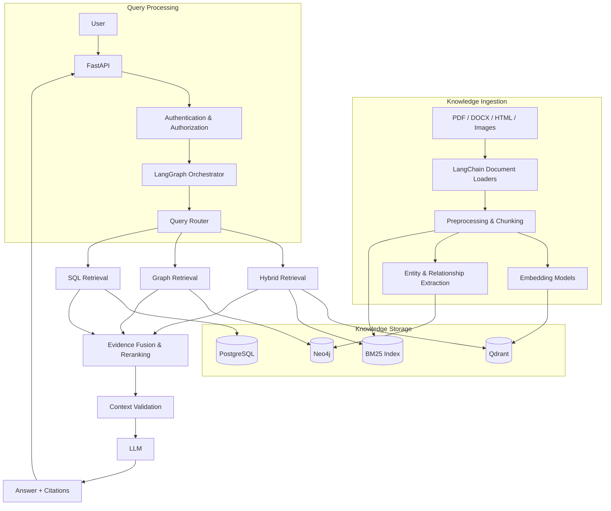

# Cognivault

### Secure Agentic Knowledge Intelligence Platform

**Cognivault** is an open-source AI engineering project focused on building a secure, intelligent, and production-oriented Retrieval-Augmented Generation (RAG) platform.

The system combines **Advanced RAG, Agentic RAG, GraphRAG, Multimodal RAG, and AI Security** to retrieve information, reason across multiple knowledge sources, and generate evidence-grounded answers.

The project uses **LangChain and LangGraph** as its primary frameworks and follows an incremental, evaluation-driven development approach.

> **Status:** 🚧 Under Development  
> **Primary Language:** Python  
> **Frameworks:** LangChain, LangGraph  
> **Deployment:** Docker Compose  
> **Architecture:** Modular Python Application

---

## 1. Project Overview

Traditional RAG systems typically follow a simple architecture:

```text
User Query
    ↓
Embedding Model
    ↓
Vector Database
    ↓
Relevant Documents
    ↓
LLM
    ↓
Generated Answer
```

Although this approach works for basic question answering, it has several limitations:

- Difficulty answering complex, multi-step questions
- Limited support for structured and unstructured data together
- Poor retrieval performance for exact identifiers and keywords
- Challenges processing images, tables, and complex PDFs
- Lack of dynamic retrieval strategies
- Risk of hallucinated or unsupported answers
- Limited security and access-control mechanisms
- Insufficient observability and evaluation

**Cognivault aims to address these limitations by progressively introducing advanced retrieval, agentic orchestration, knowledge graphs, multimodal processing, and security controls.**

The objective is not simply to create another PDF chatbot, but to build a system that demonstrates real-world AI engineering practices.

---

## 2. Project Objectives

The main objectives of Cognivault are:

1. Develop a reliable document ingestion and indexing pipeline.
2. Implement and compare different retrieval strategies.
3. Improve retrieval quality using hybrid search and reranking.
4. Build intelligent retrieval workflows using LangGraph.
5. Support multi-hop reasoning through knowledge graphs.
6. Process complex documents containing text, tables, and images.
7. Integrate structured and unstructured knowledge sources.
8. Implement secure access to enterprise knowledge.
9. Evaluate retrieval accuracy, answer quality, latency, and cost.
10. Deploy and monitor the platform using Docker Compose.

---

## 3. System Architecture

Cognivault consists of two main pipelines:

- **Indexing Pipeline:** Processes and stores enterprise knowledge.
- **Query Pipeline:** Retrieves evidence and generates grounded answers.

### 3.1 High-Level Architecture



This is the **target architecture**, not a representation of features already completed.

Authorization must be enforced within individual retrieval tools and data-access operations, not only at the API layer.

---

## 4. Core Features

### 4.1 Document Ingestion

Cognivault will support multiple document formats and sources.

**Planned capabilities:**

- PDF document loading
- DOCX document loading
- TXT and Markdown loading
- HTML document extraction
- Document metadata extraction
- Text preprocessing
- Document chunking
- Embedding generation
- Duplicate detection
- Incremental indexing

**Technologies:** LangChain Document Loaders, PyMuPDF, Python.

### 4.2 Advanced Retrieval

The retrieval engine will support multiple strategies.

| Retrieval Technique | Purpose |
|---|---|
| Dense Retrieval | Semantic similarity search |
| Sparse Retrieval | Keyword-based retrieval using BM25 |
| Hybrid Search | Combine dense and sparse retrieval |
| Reciprocal Rank Fusion | Merge retrieval rankings |
| Metadata Filtering | Restrict results using document attributes |
| Query Rewriting | Improve poorly formulated queries |
| Multi-Query Retrieval | Generate alternative search queries |
| Reranking | Improve the relevance ordering of results |
| Contextual Compression | Reduce irrelevant retrieved content |
| Parent Document Retrieval | Retrieve larger context from smaller chunks |

**Technologies:** LangChain, Qdrant, BM25, Cross-Encoders.

### 4.3 Agentic RAG

Agentic RAG introduces dynamic decision-making into retrieval workflows.

Instead of always following a fixed retrieval pipeline, the system can select appropriate retrieval tools based on the user's question.

**Planned capabilities:**

- Query classification
- Intelligent query routing
- Dynamic tool selection
- Adaptive RAG
- Corrective RAG (CRAG)
- Multi-step retrieval
- Evidence verification
- Human-in-the-loop workflows
- Controlled agent execution

**Technology:** LangGraph.

### 4.4 GraphRAG

GraphRAG enables retrieval based on relationships between entities.

**Planned capabilities:**

- Entity extraction
- Relationship extraction
- Knowledge graph construction
- Entity linking
- Graph traversal
- Multi-hop retrieval
- Graph and vector search integration

**Technologies:** Neo4j, LangChain, LangGraph.

### 4.5 Multimodal RAG

Traditional text-only retrieval may not capture important information from complex enterprise documents.

Cognivault will explore multimodal document understanding.

**Planned capabilities:**

- PDF layout analysis
- Table extraction
- Image extraction
- OCR integration
- Vision-language model integration
- Multimodal embeddings
- Retrieval over text and visual information

**Technologies:** PyMuPDF, Vision-Language Models, LangChain.

### 4.6 RAG Security

Security is a core engineering requirement.

**Planned capabilities:**

- Authentication
- Role-Based Access Control (RBAC)
- Attribute-Based Access Control (ABAC)
- Document-level authorization
- Retrieval-time permission filtering
- Prompt injection defenses
- Agent tool permission restrictions
- Sensitive data protection
- Audit logging
- Security evaluation

Security controls will be validated using reproducible tests and defined threat scenarios.

---

## 5. Technology Stack

| Category | Technology |
|---|---|
| Programming Language | Python |
| LLM Framework | LangChain |
| Agent Framework | LangGraph |
| API Framework | FastAPI |
| Vector Database | Qdrant |
| Sparse Retrieval | BM25 |
| Graph Database | Neo4j |
| Relational Database | PostgreSQL (optional) |
| Embedding Models | Sentence Transformers / API Models |
| Reranking | Cross-Encoder Models |
| Document Processing | PyMuPDF, LangChain Loaders |
| Observability | Langfuse |
| RAG Evaluation | Ragas, DeepEval |
| Testing | Pytest |
| Containerization | Docker |
| Local Deployment | Docker Compose |
| Version Control | Git + GitHub |

Technology choices may change based on performance benchmarks and implementation requirements.

---

## 6. Project Structure

Cognivault uses a simplified modular architecture.

```text
cognivault/
│
├── src/
│   └── cognivault/
│       ├── ingestion/          # Loading, preprocessing, chunking, indexing
│       ├── retrieval/          # Vector search, BM25, hybrid search, reranking
│       ├── agents/             # LangGraph and Agentic RAG workflows
│       ├── graph_rag/          # Knowledge graphs and Neo4j
│       ├── multimodal/         # Images, tables, PDFs, OCR
│       ├── security/           # Authentication, authorization, guardrails
│       ├── evaluation/         # Retrieval and generation evaluation
│       ├── core/               # Configuration, LLMs, embeddings
│       └── api.py              # FastAPI application
│
├── experiments/                # Experiments and benchmark comparisons
│
├── tests/                      # Unit, integration, evaluation, security tests
│
├── data/                       # Sample documents and evaluation datasets
│
├── docs/                       # Architecture and technical documentation
│
├── .env.example
├── .gitignore
├── pyproject.toml
├── docker-compose.yml
├── ROADMAP.md
└── README.md
```

### Directory Responsibilities

| Directory | Responsibility |
|---|---|
| `ingestion/` | Loading, preprocessing, chunking, indexing |
| `retrieval/` | Dense, sparse, hybrid retrieval, reranking |
| `agents/` | LangGraph orchestration and agentic workflows |
| `graph_rag/` | Knowledge graph construction and retrieval |
| `multimodal/` | Image, table, and complex document processing |
| `security/` | Authorization, isolation, and guardrails |
| `evaluation/` | Quality metrics and benchmarking |
| `core/` | Shared configuration, model clients, embeddings |
| `experiments/` | Retrieval and model comparison experiments |
| `tests/` | Automated testing |
| `data/` | Sample documents and test datasets |
| `docs/` | Architecture, design decisions, technical explanations |

---

## 7. Development Roadmap

The project will be developed incrementally.

### Phase 1 — Basic RAG

**Goal:** Build a working, measurable RAG baseline.

- [ ] Document loading
- [ ] Text preprocessing
- [ ] Chunking
- [ ] Embedding generation
- [ ] Qdrant integration
- [ ] Similarity search
- [ ] Basic LangChain RAG pipeline
- [ ] Source citations
- [ ] Baseline evaluation

**Deliverable:** Functional RAG API with a vector database.

### Phase 2 — Advanced Retrieval

**Goal:** Improve retrieval accuracy and relevance.

- [ ] BM25 retrieval
- [ ] Hybrid search
- [ ] Reciprocal Rank Fusion
- [ ] Query rewriting
- [ ] Multi-query retrieval
- [ ] Metadata filtering
- [ ] Cross-encoder reranking
- [ ] Retrieval performance evaluation

**Deliverable:** Hybrid RAG system with comparative benchmarks.

### Phase 3 — Agentic RAG

**Goal:** Build intelligent retrieval orchestration.

- [ ] LangGraph workflow
- [ ] Query classification
- [ ] Query routing
- [ ] Dynamic retrieval tool selection
- [ ] Adaptive RAG
- [ ] Corrective RAG
- [ ] Multi-step retrieval
- [ ] Human-in-the-loop support

**Deliverable:** Agentic RAG workflow capable of selecting retrieval strategies.

### Phase 4 — GraphRAG

**Goal:** Support relationship-based and multi-hop retrieval.

- [ ] Entity extraction
- [ ] Relationship extraction
- [ ] Knowledge graph construction
- [ ] Neo4j integration
- [ ] Graph traversal
- [ ] Graph + vector retrieval
- [ ] Multi-hop question answering

**Deliverable:** Graph-enhanced RAG system.

### Phase 5 — Multimodal RAG

**Goal:** Process complex documents beyond plain text.

- [ ] PDF layout processing
- [ ] Table extraction
- [ ] OCR
- [ ] Image understanding
- [ ] Vision-language model integration
- [ ] Multimodal retrieval
- [ ] Multimodal evaluation

**Deliverable:** Multimodal document intelligence pipeline.

### Phase 6 — Security

**Goal:** Protect enterprise knowledge and agent execution.

- [ ] Authentication
- [ ] RBAC / ABAC
- [ ] Document-level permissions
- [ ] Retrieval authorization
- [ ] Prompt injection testing
- [ ] Tool execution restrictions
- [ ] Sensitive information protection
- [ ] Audit logging
- [ ] Security test suite

**Deliverable:** Security-tested RAG system.

Basic security controls should be introduced from Phase 1 rather than postponed until Phase 6.

### Phase 7 — Production Engineering

**Goal:** Improve reliability, observability, and deployment.

- [ ] FastAPI service improvements
- [ ] Asynchronous processing
- [ ] Background task processing
- [ ] Retry and timeout handling
- [ ] Idempotent ingestion
- [ ] Unit and integration tests
- [ ] Langfuse tracing
- [ ] Automated evaluation
- [ ] Docker Compose deployment
- [ ] Logging and monitoring
- [ ] Performance testing

**Deliverable:** Containerized, observable, and maintainable RAG platform.

---

## 8. Evaluation and Benchmarking

Evaluation is a core part of the project.

Every major retrieval improvement should be compared against the previous baseline using a consistent evaluation dataset.

### 8.1 Retrieval Evaluation

| Metric | Purpose |
|---|---|
| Recall@K | Measures relevant documents retrieved within the top K |
| Precision@K | Measures relevance of the top K results |
| MRR | Measures how early the first relevant result appears |
| NDCG@K | Evaluates relevance-aware ranking quality |
| Retrieval Latency | Measures retrieval response time |

### 8.2 Generation Evaluation

- Answer correctness
- Faithfulness
- Context relevance
- Citation accuracy
- Hallucination / unsupported claim rate

### 8.3 System Performance

- End-to-end response latency
- Token consumption
- Estimated LLM cost
- Throughput
- API error rate
- Retrieval failures

### 8.4 Security Evaluation

- Unauthorized retrieval rate
- Cross-user or cross-tenant data leakage
- Prompt injection attack success rate
- Agent tool-policy violations

Benchmark results will be documented in `experiments/` and `docs/`.

---

## 9. Example Use Cases

### Enterprise Knowledge Assistant

Answer employee and operational questions using internal documents and policies.

### Financial Knowledge Intelligence

Retrieve information from financial statements, compliance documents, and regulatory policies.

### Technical Research Assistant

Analyze research papers and technical documents, compare findings, and produce evidence-grounded answers.

### Supply Chain Intelligence

Retrieve information from supplier documents, warehouse records, inventory data, and operational procedures.

### Compliance Assistant

Answer policy-related questions while respecting user permissions and maintaining audit records.

---

## 10. Development Strategy

Cognivault follows a **project-driven learning and development approach**.

Each major capability will follow this process:

1. **Understand:** Study the underlying concept and its limitations.
2. **Implement:** Develop the feature using LangChain, LangGraph, or supporting libraries.
3. **Test:** Validate functionality through automated tests.
4. **Evaluate:** Measure quality, latency, and cost.
5. **Compare:** Benchmark against the previous implementation.
6. **Document:** Record findings, trade-offs, and architectural decisions.

Advanced features will be introduced when they solve a demonstrated problem or provide measurable benefits.

---

## 11. Getting Started

> Installation instructions will be finalized as the Phase 1 implementation becomes available.

### Prerequisites

- Python 3.11 or later, subject to dependency compatibility
- Git
- Docker and Docker Compose
- Access to an LLM provider or compatible local model
- An embedding model

### Clone the Repository

```bash
git clone https://github.com/YOUR_USERNAME/cognivault.git
cd cognivault
```

Replace `YOUR_USERNAME` with your GitHub username.

### Create a Virtual Environment

```bash
python -m venv .venv
source .venv/bin/activate
```

For Windows:

```powershell
.venv\Scripts\activate
```

### Install Dependencies

Once the project package configuration is implemented:

```bash
pip install -e .
```

### Configure Environment Variables

```bash
cp .env.example .env
```

Configure the required model provider credentials and service connections.

Never commit `.env` or real API credentials.

### Start Infrastructure

Once the Docker Compose services are configured:

```bash
docker compose up -d
```

### Run the API

Once the FastAPI application is implemented:

```bash
uvicorn cognivault.api:app --reload
```

### Run Tests

```bash
pytest
```

**Note:** The commands above describe the intended development workflow. Some steps will become operational only after the corresponding project files and services are implemented.

---

## 12. Engineering Principles

### Modular Design

Each component should have a clearly defined responsibility and be independently testable.

### Evaluation-Driven Development

Retrieval strategies and agent workflows should be compared using reproducible benchmarks.

### Security by Design

Authentication, authorization, data isolation, and tool permissions must be enforced at appropriate system boundaries.

### Reliability

The system should handle invalid inputs, timeouts, retries, and service failures predictably.

### Observability

Important operations should be traceable, including retrieval decisions, agent tool calls, model responses, and failures.

### Simplicity Before Complexity

Start with a working baseline. Introduce advanced architectures only when they address measurable limitations.

---

## 13. Future Research Directions

Potential future extensions include:

- Self-improving retrieval pipelines
- Context-aware retrieval security
- Retrieval poisoning detection
- Automated retrieval strategy optimization
- Advanced agent memory architectures
- Graph-enhanced agent reasoning
- Long-context retrieval optimization
- Adaptive chunking
- Query-dependent retrieval selection
- Secure multi-agent knowledge workflows

These are exploratory directions rather than committed project features.

---

## 14. Contributing

Contributions, suggestions, bug reports, and reproducible experiments are welcome.

Contribution guidelines may be added as the project matures.

---

## 15. License

A license will be selected before public distribution.

---

**Cognivault — From Retrieval to Knowledge Intelligence.**